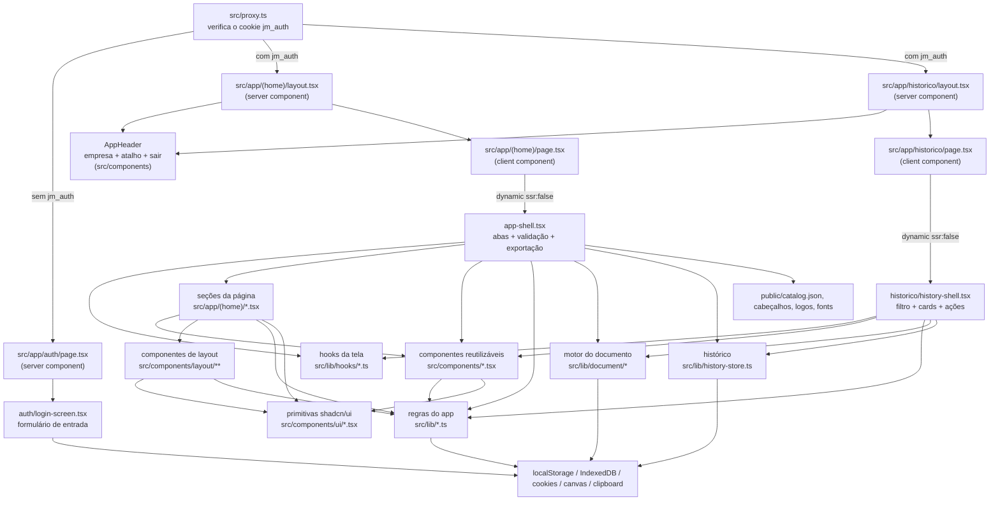
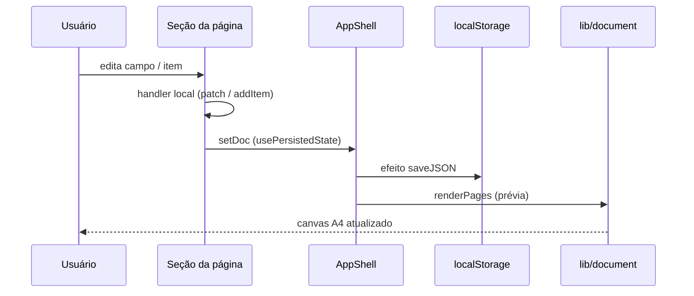

# Arquitetura

## Visão geral

O J&M System é uma aplicação **client-side**. O servidor Next.js só entrega o
HTML/JS e os arquivos estáticos; login, documentos, cálculo, persistência e
exportação acontecem no navegador.

Consequências diretas:

- Não existe banco de dados, API route nem server action. O único código de
  servidor é `src/proxy.ts`, que verifica o cookie `jm_auth` e manda quem não está
  autenticado para `/auth`.
- Os dados vivem no `localStorage` (documento em edição) e no `IndexedDB`
  (histórico) do navegador de quem usa (ver [DATA-MODEL.md](./DATA-MODEL.md)).
- O documento A4 é desenhado em `<canvas>` por código imperativo, não por HTML/CSS
  (ver [DOCUMENT-ENGINE.md](./DOCUMENT-ENGINE.md)).
- O catálogo é um arquivo estático (`public/catalog.json`), atualizado por um
  workflow do GitHub Actions (ver [CATALOG.md](./CATALOG.md)).

Stack: Next.js 16 (App Router), React 19, TypeScript estrito, Tailwind CSS 4,
shadcn/ui (`style: base-nova`) sobre Base UI, Lucide para ícones, `@floating-ui/react`
para listas flutuantes, Dexie sobre IndexedDB para o histórico e
`@tanstack/react-virtual` para virtualizar a lista do histórico.

## Camadas e dependências



Regras de dependência:

- `src/app` pode importar `src/components` e `src/lib`.
- `src/components` pode importar `src/lib` e `src/components/ui`.
- `src/components/layout` especializa uma primitiva para uma funcionalidade do
  app; pode importar `src/lib`, `src/components/ui` e outros componentes de
  layout, nunca `src/app`.
- `src/lib` **não** importa componentes React nem nada de `src/app`.
- `src/lib/hooks` é a única exceção dentro de `src/lib`: pode usar React
  (`useState`, `useEffect`, …), mas só importa outros módulos de `src/lib` — nunca
  `src/app`, `src/components` ou `src/components/ui`.
- `src/lib/document` não importa componentes React; só usa Canvas, imagens e
  utilidades puras.
- `src/components/ui` é gerado pelo shadcn; não deve ganhar regra de negócio.

## Árvore de arquivos

```
orcamento/
├── docs/                          documentação obrigatória (esta pasta)
├── e2e/                           testes de interface com Playwright
│   ├── support/app.ts             cookie de sessão + documento semeado
│   ├── client-fields.spec.ts      validação dos campos do cliente
│   ├── budget-items.spec.ts       validação dos itens do orçamento
│   ├── export-gating.spec.ts      exportação bloqueada enquanto há erro
│   ├── company.spec.ts            escolha/troca de empresa (login, cabeçalho, histórico)
│   ├── share.spec.ts              celular compartilha só o arquivo; computador baixa
│   └── history.spec.ts            histórico: filtro, card salvo e pedir orçamento
├── public/
│   ├── catalog.json               catálogo [nome, slug, categoria] — ~2.788 itens
│   ├── header.png                 cabeçalho J&M usado nos documentos
│   ├── header-vision-tech.png     cabeçalho Vision Tech (mesmo desenho, faixa prata)
│   ├── logo-vision-tech.png       marca Vision Tech para o cabeçalho do site e o login
│   └── fonts/                     Arimo e Open Sans (tela e canvas)
├── scripts/
│   └── atualizar-catalogo.mjs     atualiza o catálogo pelo sitemap da loja
├── src/
│   ├── app/
│   │   ├── (home)/                rota / e as seções da tela principal
│   │   │   ├── layout.tsx         layout da rota: cabeçalho (AppHeader) e fundo
│   │   │   ├── page.tsx           carrega o AppShell com dynamic ssr:false
│   │   │   ├── app-shell.tsx      abas, validação, exportação + DocumentPreview
│   │   │   ├── budget-form.tsx    orçamento + ProductSearch/BudgetItems
│   │   │   ├── receipt-form.tsx   recibo + ReceiptItems/SignaturePanel
│   │   │   ├── client-fields.tsx  cliente/data/CNPJ (os dois modos)
│   │   │   ├── action-bar.tsx     exportar, copiar e limpar
│   │   │   ├── mobile-preview.tsx prévia em tela cheia no celular
│   │   │   └── images-dialog.tsx  salvar imagem quando a cópia falha
│   │   ├── historico/             rota /historico (documentos salvos)
│   │   │   ├── layout.tsx         layout da rota: cabeçalho (AppHeader) e fundo
│   │   │   ├── page.tsx           carrega o HistoryShell com dynamic ssr:false
│   │   │   └── history-shell.tsx  filtro, cards e ações + HistoryCard
│   │   ├── auth/                  rota /auth (tela de login)
│   │   │   ├── login-screen.tsx
│   │   │   └── page.tsx
│   │   ├── favicon.ico
│   │   ├── globals.css            Tailwind, fontes, tokens e estilos do documento
│   │   └── layout.tsx             layout raiz (metadata, lang pt-BR)
│   ├── proxy.ts                   redireciona para /auth sem o cookie jm_auth
│   ├── components/
│   │   ├── layout/                componentes especializados (primitiva + app)
│   │   │   └── Form/
│   │   │       ├── form.layout.tsx    Form + useFormContext (valores/dirty/erros/isValid)
│   │   │       ├── field.tsx          liga um campo ao contexto (id, erro, setter)
│   │   │       └── input/
│   │   │           ├── input.layout.tsx          InputLayout (campo de texto)
│   │   │           └── money-input.layout.tsx    MoneyInputLayout (valor em R$)
│   │   ├── app-header.tsx          cabeçalho das rotas protegidas (empresa, atalho, sair)
│   │   ├── share-files-dialog.tsx  “Enviar arquivo” quando o celular pede outro toque
│   │   ├── auto-grow-textarea.tsx
│   │   ├── brand-logo.tsx
│   │   ├── money-input.tsx
│   │   ├── product-thumb.tsx
│   │   └── ui/                    primitivas shadcn/ui
│   └── lib/
│       ├── __tests__/lib.test.ts   testes de regra (bun test)
│       ├── unit/search.test.ts     testes unitários da busca (vitest)
│       ├── unit/form.test.ts       testes unitários do formulário (vitest)
│       ├── auth.ts                 credenciais e sessão
│       ├── catalog.ts              parse, categorias e busca do catálogo
│       ├── companies.ts            empresas (J&M, Vision Tech): rodapé, assinante, cabeçalho
│       ├── document/               motor do A4 e exportação (export.ts, render.ts…)
│       ├── hooks/                  hooks de tela (catalog, flash, persisted-state…)
│       ├── documents.ts            documentos novos (padrões)
│       ├── form.ts                 dirty/erros por campo a partir de um schema zod
│       ├── format.ts               dinheiro, data, CNPJ, id e foto
│       ├── history.ts              entrada do histórico e texto do “pedir orçamento”
│       ├── history-store.ts        IndexedDB (Dexie): gravar, listar, expirar e restaurar
│       ├── schemas/                validações zod por assunto (budget.ts, history.ts…)
│       ├── search.ts               busca exata + fuzzy e destaque
│       ├── storage.ts              chaves e leitura/gravação segura no localStorage
│       ├── totals.ts               totais do orçamento e do recibo
│       ├── types.ts                tipos do domínio
│       ├── utils.ts                `cn` (classes)
│       └── version.ts              versão lida do package.json
├── .github/workflows/              catálogo automático e criação de Release
├── AGENTS.md                       regras para agentes de IA
├── CHANGELOG.md                    histórico por versão
├── LEIAME.md                       guia do usuário/final e operação
├── components.json                 configuração do shadcn
├── bunfig.toml                     bun test ignora e2e/** (Playwright)
├── next.config.ts                  rewrite /foto/:id e cache
├── package.json                    scripts, dependências e versão
├── playwright.config.ts            testes de interface (Playwright, porta 3100)
├── tsconfig.json                   TypeScript estrito + alias @/*
├── vitest.config.mts               testes de src/**/unit
└── eslint.config.mjs               ESLint (next core-web-vitals + TS)
```

## Camadas de componente

| Camada | Onde | O que é |
| --- | --- | --- |
| Primitiva | `src/components/ui/` | Componente cru (shadcn/ui): só a lógica da própria funcionalidade, sem conhecimento do app. |
| Reutilizável | `src/components/*.tsx` | Componente do projeto usado por mais de uma página, ainda sem conhecer o documento. |
| Layout | `src/components/layout/**` | Especialização de uma primitiva (ou de um reutilizável) para uma funcionalidade do projeto. |

Regra do layout: a primitiva não sabe *o que* está editando; o layout sabe.
`InputLayout` recebe `name`, busca o formulário no contexto e grava apenas aquele
campo — sem receber `value`/`onChange`. A ligação com o contexto fica em
`layout/Form/field.tsx` (`useFieldBinding`), compartilhada por `InputLayout` e
`MoneyInputLayout`.

Toda primitiva especializada por um layout precisa de:

1. **testes com vitest** da lógica que ela isola (`src/lib/unit/*.test.ts`, quando
   a regra é extraível; ver [DEVELOPMENT.md](./DEVELOPMENT.md));
2. **teste de interface com Playwright** em `e2e/*.spec.ts`, cobrindo os estados
   que o layout decide (válido, inválido depois de editado, mensagem de erro e
   efeito nos botões de exportação).

Subpastas em PascalCase (`layout/Form/`) são intencionais: cada pasta agrupa uma
especialização e seus arquivos `*.layout.tsx`.

## Fluxo de dados

Não há store global (Redux, Zustand): o estado do documento vive no `AppShell`.
`Context` aparece só em escopo de formulário, que não guarda cópia dos valores. O
padrão é:

1. **`AppShell`** guarda o estado que cruza modos (`orc`, `rec`, `mode`,
   assinatura, preços) — sempre através de `usePersistedState` — além de aviso,
   exportação e diálogo de imagens.
2. Seções de página são **controladas**: recebem `doc`/`products` e o setter do
   documento. Não guardam cópia do documento.
3. Quem muda o documento é a própria seção que o edita
   (`budget-form.tsx`, `receipt-form.tsx`), chamando o setter recebido; o hook
   `usePersistedState` grava no `localStorage`.
4. Efeitos de carregamento (cabeçalho, catálogo, assinatura, breakpoint) moram em
   hooks (`src/lib/hooks/`), nunca no `AppShell`.
5. A prévia e a exportação leem o mesmo estado — não existe “documento paralelo”.
6. **Contexto de formulário** (`src/components/layout/Form/form.layout.tsx`):
   `Form` recebe `values` + `onValuesChange` de quem é dono do estado, calcula os
   erros com o schema zod e guarda quais campos foram editados (`dirty`). Cada
   `InputLayout` grava um único campo; o campo só aparece inválido depois de
   editado. O contexto também expõe `isValid` (nenhum erro no schema),
   independente de `dirty`.
7. Cada formulário tem seu próprio contexto: `ClientFields` usa
   `clientFieldsSchema`; cada linha de `BudgetItems` usa um `Form` com
   `budgetItemSchema`, então o erro de quantidade/valor aparece na própria linha.
8. `AppShell.validate()` continua sendo a validação da exportação: ela foca o
   primeiro campo inválido (`o-cliente`/`r-cliente`) e valida os itens.
9. `AppShell` calcula a validade do documento (`budgetFormSchema`/`receiptFormSchema`
   + `formErrors`/`formIsValid`, de `src/lib/form.ts`) e repassa `isValid` ao
   `ActionBar`, que desabilita PDF/PNG/copiar enquanto houver erro.



## Fluxo de exportação

1. `ActionBar` dispara `handleDownloadPdf`, `handleDownloadPng` ou `handleCopyImage`.
2. `AppShell.validate()` exige cliente e valida os itens com zod (ao menos um
   item, quantidade e valor unitário maiores que zero).
3. `renderExportPages()` (em `src/lib/document/export.ts`, compartilhado com o
   histórico) aguarda fontes, cabeçalho e fotos e chama `renderPages` com
   `EXPORT_SCALE` (~200 dpi).
4. `buildPDF` monta o PDF (uma imagem JPEG por página) ou `canvasToBlob` gera PNG.
5. `documentName` cria o nome do arquivo e `deliverFiles` entrega: baixa no
   computador e, no celular, abre a tela de compartilhar só com o arquivo (se o
   celular pedir outro toque, `ShareFilesDialog` mostra “Enviar arquivo”).
6. A exportação concluída chama `saveToHistory()`: o documento inteiro (e a
   assinatura usada) vai para o IndexedDB com o `documentId` atual.
7. Se a cópia para a área de transferência falhar, `ImagesDialog` mostra a imagem
   para salvar manualmente.

Detalhes em [DOCUMENT-ENGINE.md](./DOCUMENT-ENGINE.md).

## Fluxo do histórico

1. `HistoryShell` chama `useHistoryEntries`, que lê o IndexedDB via
   `listHistoryEntries` (descartando o que passou de 30 dias).
2. O filtro local (`orc` por padrão) separa orçamentos de recibos; cada card
   mostra cliente, data e total já gravados na entrada.
3. `HistoryList` virtualiza a grade com `useVirtualizer`
   (`@tanstack/react-virtual`): só os cards visíveis são montados. A altura vem
   de `measureElement` (partindo de 92 px) e as colunas de `lanes` (1, 2 ou 3,
   medidas pelo `ResizeObserver` da própria lista). Por isso a rolagem é da lista
   (`overflow-y-auto`), não da página.
4. **Abrir** usa `restoreHistoryEntry` (documento, modo, assinatura e id voltam ao
   `localStorage`) e navega para `/`.
5. **Baixar** redesenha o documento salvo com `renderExportPages` + `loadSignature`
   e baixa o PDF — o arquivo nunca fica guardado.
6. **Pedir orçamento** monta o texto com `quoteText` e copia para a área de
   transferência.

Detalhes do modelo em [DATA-MODEL.md](./DATA-MODEL.md#histórico-indexeddb).

## Renderização client-only

- `src/app/layout.tsx` é server component: metadados, `lang="pt-BR"` e classes do
  `<body>`.
- `src/app/(home)/layout.tsx` e `src/app/historico/layout.tsx` são **server
  components**: desenham o fundo da página e o `AppHeader` compartilhado
  (`src/components/app-header.tsx`). O cabeçalho aparece na primeira pintura; só o
  ícone alterna (via `usePathname`).
- `src/proxy.ts` roda antes das rotas e libera a requisição somente com
  `jm_auth=1`; sem o cookie, redireciona para `/auth`.
- `src/app/auth/page.tsx` renderiza `LoginScreen`; ao entrar, o cookie é gravado e
  o navegador segue para `/`.
- `src/app/(home)/page.tsx` e `src/app/historico/page.tsx` são **client
  components** (`"use client"`) e carregam `AppShell`/`HistoryShell` com
  `dynamic(..., { ssr: false })` porque o estado inicial depende de `localStorage`
  e de `IndexedDB`. O `dynamic` com `ssr: false` não é permitido em server
  component no Next 16 — é por isso que os `page.tsx` são clientes.
- Por isso, **não** importe `app-shell` nem `history-shell` diretamente em um
  server component e não remova o `ssr: false` sem mover a leitura de
  `localStorage`/`IndexedDB` para dentro de efeitos.

## Onde colocar código novo

| O que você está criando | Onde | Observações |
| --- | --- | --- |
| Página/rota nova | `src/app/<rota>/page.tsx` | Crie a pasta da rota. |
| Seção de uma página | `src/app/<rota>/*.tsx` | Importe com caminho relativo (`./secao`). |
| Componente usado por **um** arquivo só | Topo desse arquivo | Não criar arquivo novo: declare fora da função do componente chamador. |
| Cabeçalho/chrome de uma rota | `src/app/<rota>/layout.tsx` | Declare o cabeçalho no próprio layout; não colocar nele estado do documento. Se duas rotas compartilham o mesmo cabeçalho, ele vai para `src/components` (ex.: `app-header.tsx`). |
| Componente usado em mais de uma página | `src/components/*.tsx` | Sem conhecimento de documento. |
| Componente que especializa uma primitiva | `src/components/layout/<Grupo>/<nome>.layout.tsx` | A primitiva precisa de teste vitest e de cobertura em `e2e/` (Playwright). |
| Teste de interface | `e2e/<assunto>.spec.ts` | Playwright; helpers em `e2e/support/app.ts`. |
| Hook de estado/efeito de tela | `src/lib/hooks/<nome>.ts` | Nome sem `use-`; exporta `use<Nome>`. |
| Primitiva de UI | `src/components/ui/` | Use `bunx shadcn@latest add <nome>`. |
| Cálculo/regra de negócio | `src/lib/*.ts` | Funções puras sempre que possível. |
| Persistência no navegador | `src/lib/storage.ts` (localStorage) ou `src/lib/history-store.ts` (IndexedDB) | Toda escrita passa por um desses dois módulos. |
| Validação de dados/regra de negócio | `src/lib/schemas/<assunto>.ts` | Sempre com schema zod e teste correspondente. |
| Desenho/exportação do documento | `src/lib/document/` | Só Canvas e utilidades puras. |
| Teste de regra | `src/lib/__tests__/lib.test.ts` | `bun test`. |
| Teste unitário isolado | `src/lib/unit/<nome>.test.ts` | `vitest`. |
| Script operacional | `scripts/*.mjs` | Rodado por Bun/Node, fora do app. |

## Convenções de código

- Arquivos em **kebab-case** (`budget-form.tsx`, `money-input.tsx`).
- Pastas de layout usam **PascalCase** para o grupo e kebab-case para o arquivo
  (`layout/Form/input/input.layout.tsx`).
- Componentes em **PascalCase**, funções e hooks em **camelCase**.
- Abreviações do domínio existentes: `orc` (orçamento), `rec` (recibo),
  `sig` (assinatura), `tot` (total), `qty` (quantidade), `unit` (valor unitário).
  Mantenha-as para não divergir do código atual.
- Imports: caminho relativo entre arquivos da mesma página; alias `@/` para o resto.
- Classes CSS: Tailwind utilitário; combinar condicionalmente com `cn()`
  (`src/lib/utils.ts`).
- Ícones: `lucide-react`; tamanho padrão via classes (`size-4`).
- Acessibilidade: rótulos e `aria-label` em português, como nos componentes atuais.
- Sem `any` novo; o projeto usa TypeScript estrito.

## Restrições que não devem ser quebradas

- **Sem backend.** Não introduza rotas de API, banco ou autenticação real. O
  `src/proxy.ts` apenas faz a checagem otimista do cookie `jm_auth` para escolher
  entre `/` e `/auth`.
- **Sem dependências pesadas** para gerar PDF (o PDF é montado à mão em
  `src/lib/document/pdf.ts`). Novas bibliotecas exigem justificativa e atualização
  desta documentação.
- **Imagens do PDF vêm do próprio site** (`/foto/:id`), porque o canvas não desenha
  imagem de outra origem no arquivo exportado. O repasse está em `next.config.ts`.
- **O documento é A4 em pontos (pt)**, com `PW = 595.5` e `PH = 842.25`. Medidas do
  layout não são pixels de tela.
- **Nada é enviado para servidor.** Dados de cliente, preços, assinatura e
  histórico ficam apenas no navegador; o único cookie é o `jm_auth`.
- **O histórico não guarda arquivos** e se apaga sozinho depois de 30 dias
  (`HISTORY_TTL_DAYS`); não troque o IndexedDB por `localStorage` sem revisar o
  tamanho dos dados.
