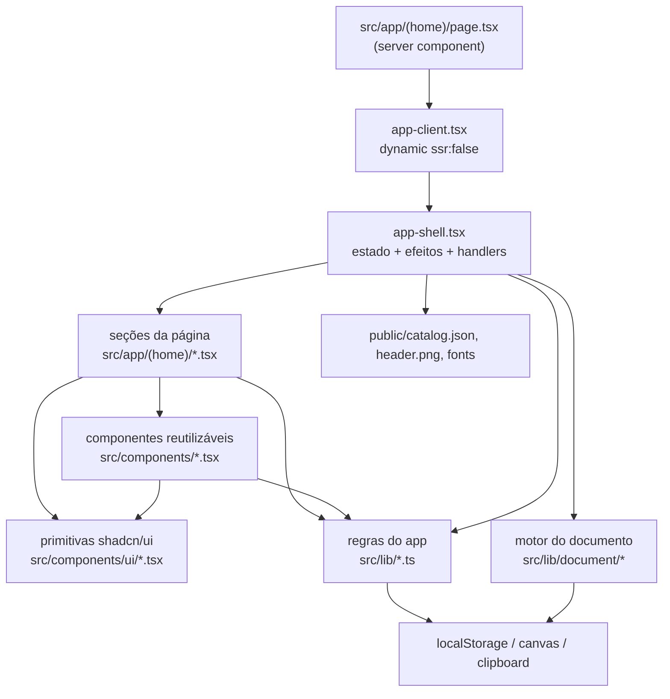
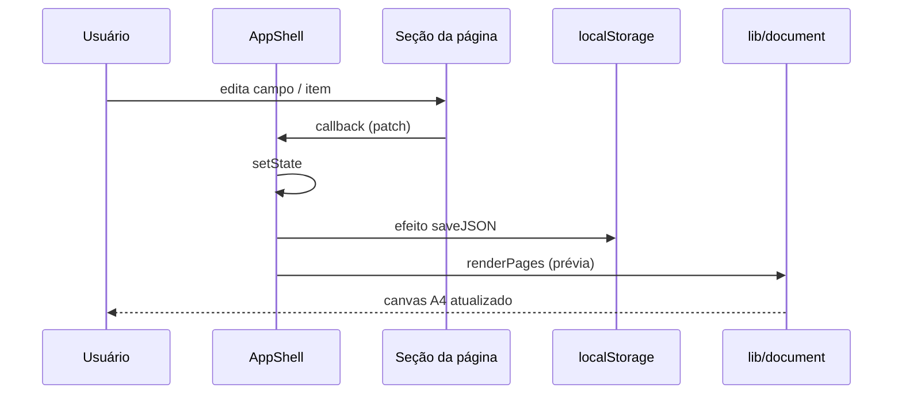

# Arquitetura

## Visão geral

O J&M System é uma aplicação **client-side**. O servidor Next.js só entrega o
HTML/JS e os arquivos estáticos; login, documentos, cálculo, persistência e
exportação acontecem no navegador.

Consequências diretas:

- Não existe banco de dados, API route, server action ou sessão de servidor.
- Os dados vivem no `localStorage` do navegador de quem usa (ver
  [DATA-MODEL.md](./DATA-MODEL.md)).
- O documento A4 é desenhado em `<canvas>` por código imperativo, não por HTML/CSS
  (ver [DOCUMENT-ENGINE.md](./DOCUMENT-ENGINE.md)).
- O catálogo é um arquivo estático (`public/catalog.json`), atualizado por um
  workflow do GitHub Actions (ver [CATALOG.md](./CATALOG.md)).

Stack: Next.js 16 (App Router), React 19, TypeScript estrito, Tailwind CSS 4,
shadcn/ui (`style: base-nova`) sobre Base UI, Lucide para ícones, `@floating-ui/react`
para listas flutuantes.

## Camadas e dependências



Regras de dependência:

- `src/app` pode importar `src/components` e `src/lib`.
- `src/components` pode importar `src/lib` e `src/components/ui`.
- `src/lib` **não** importa componentes React nem nada de `src/app`.
- `src/lib/document` não importa componentes React; só usa Canvas, imagens e
  utilidades puras.
- `src/components/ui` é gerado pelo shadcn; não deve ganhar regra de negócio.

## Árvore de arquivos

```
orcamento/
├── docs/                          documentação obrigatória (esta pasta)
├── public/
│   ├── catalog.json               catálogo [nome, slug, categoria] — ~2.788 itens
│   ├── header.png                 cabeçalho J&M usado nos documentos
│   └── fonts/                     Arimo e Open Sans (tela e canvas)
├── scripts/
│   └── atualizar-catalogo.mjs     atualiza o catálogo pelo sitemap da loja
├── src/
│   ├── app/
│   │   ├── (home)/                rota / e todas as seções da tela
│   │   ├── favicon.ico
│   │   ├── globals.css            Tailwind, fontes, tokens e estilos do documento
│   │   └── layout.tsx             layout raiz (metadata, lang pt-BR)
│   ├── components/
│   │   ├── auto-grow-textarea.tsx
│   │   ├── brand-logo.tsx
│   │   ├── money-input.tsx
│   │   ├── product-thumb.tsx
│   │   └── ui/                    primitivas shadcn/ui
│   └── lib/
│       ├── __tests__/lib.test.ts   testes de regra (bun test)
│       ├── unit/search.test.ts     testes unitários da busca (vitest)
│       ├── auth.ts                 credenciais e sessão
│       ├── catalog.ts              parse, categorias e busca do catálogo
│       ├── document/               motor do A4 e exportação
│       ├── documents.ts            documentos novos (padrões)
│       ├── format.ts               dinheiro, data, CNPJ, id e foto
│       ├── search.ts               busca exata + fuzzy e destaque
│       ├── storage.ts              leitura/gravação segura no localStorage
│       ├── totals.ts               totais do orçamento e do recibo
│       ├── types.ts                tipos do domínio
│       ├── utils.ts                `cn` (classes)
│       └── version.ts              versão lida do package.json
├── .github/workflows/              catálogo automático e criação de Release
├── AGENTS.md                       regras para agentes de IA
├── CHANGELOG.md                    histórico por versão
├── LEIAME.md                       guia do usuário/final e operação
├── components.json                 configuração do shadcn
├── next.config.ts                  rewrite /foto/:id e cache
├── package.json                    scripts, dependências e versão
├── tsconfig.json                   TypeScript estrito + alias @/*
├── vitest.config.mts               testes de src/**/unit
└── eslint.config.mjs               ESLint (next core-web-vitals + TS)
```

## Fluxo de dados

Não há store global (Redux, Zustand, Context). O padrão é:

1. **`AppShell`** é o único dono do estado do app (`orc`, `rec`, `mode`, assinatura,
   preços, catálogo, avisos).
2. Seções de página são **controladas**: recebem `doc`/`products` e callbacks
   (`onPatch`, `onUpdateItem`, …). Não guardam cópia do documento.
3. Toda alteração sobe para `AppShell`, que atualiza o estado e deixa os efeitos de
   persistência gravarem no `localStorage`.
4. A prévia e a exportação leem o mesmo estado — não existe “documento paralelo”.



## Fluxo de exportação

1. `ActionBar` dispara `handleDownloadPdf`, `handleDownloadPng` ou `handleCopyImage`.
2. `AppShell.validate()` exige cliente e ao menos um item.
3. `renderExportPages()` aguarda fontes, cabeçalho e fotos e chama `renderPages`
   com `EXPORT_SCALE` (~200 dpi).
4. `buildPDF` monta o PDF (uma imagem JPEG por página) ou `canvasToBlob` gera PNG.
5. `documentName` cria o nome do arquivo e `downloadBlob` baixa.
6. Se a cópia para a área de transferência falhar, `ImagesDialog` mostra a imagem
   para salvar manualmente.

Detalhes em [DOCUMENT-ENGINE.md](./DOCUMENT-ENGINE.md).

## Renderização client-only

- `src/app/layout.tsx` é server component: metadados, `lang="pt-BR"` e classes do
  `<body>`.
- `src/app/(home)/page.tsx` só renderiza `<AppClient />`.
- `app-client.tsx` carrega `AppShell` com `dynamic(..., { ssr: false })` porque o
  estado inicial depende de `localStorage`.
- Por isso, **não** importe `app-shell` diretamente em um server component e não
  remova o `ssr: false` sem mover a leitura de `localStorage` para dentro de
  efeitos.

## Onde colocar código novo

| O que você está criando | Onde | Observações |
| --- | --- | --- |
| Página/rota nova | `src/app/<rota>/page.tsx` | Crie a pasta da rota. |
| Seção de uma página | `src/app/<rota>/*.tsx` | Importe com caminho relativo (`./secao`). |
| Componente usado em mais de uma página | `src/components/*.tsx` | Sem conhecimento de documento. |
| Primitiva de UI | `src/components/ui/` | Use `bunx shadcn@latest add <nome>`. |
| Cálculo/regra de negócio | `src/lib/*.ts` | Funções puras sempre que possível. |
| Desenho/exportação do documento | `src/lib/document/` | Só Canvas e utilidades puras. |
| Teste de regra | `src/lib/__tests__/lib.test.ts` | `bun test`. |
| Teste unitário isolado | `src/lib/unit/<nome>.test.ts` | `vitest`. |
| Script operacional | `scripts/*.mjs` | Rodado por Bun/Node, fora do app. |

## Convenções de código

- Arquivos em **kebab-case** (`budget-items.tsx`, `money-input.tsx`).
- Componentes em **PascalCase**, funções e hooks em **camelCase**.
- Abreviações do domínio existentes: `orc` (orçamento), `rec` (recibo),
  `sig` (assinatura), `tot` (total), `qty` (quantidade), `unit` (valor unitário).
  Mantenha-as para não divergir do código atual.
- Imports: caminho relativo entre arquivos da mesma página; alias `@/` para o resto.
- Classes CSS: Tailwind utilitário; combinar condicionalmente com `cn()`
  (`src/lib/utils.ts`).
- Ícones: `lucide-react`; tamanho padrão via classes (`size-4`).
- Acessibilidade: rótulos e `aria-label` em português, como nos componentes atuais.
- Sem `any` novo; o projeto usa TypeScript estrito.

## Restrições que não devem ser quebradas

- **Sem backend.** Não introduza rotas de API, banco ou autenticação de servidor.
- **Sem dependências pesadas** para gerar PDF (o PDF é montado à mão em
  `src/lib/document/pdf.ts`). Novas bibliotecas exigem justificativa e atualização
  desta documentação.
- **Imagens do PDF vêm do próprio site** (`/foto/:id`), porque o canvas não desenha
  imagem de outra origem no arquivo exportado. O repasse está em `next.config.ts`.
- **O documento é A4 em pontos (pt)**, com `PW = 595.5` e `PH = 842.25`. Medidas do
  layout não são pixels de tela.
- **Nada é enviado para servidor.** Dados de cliente, preços e assinatura ficam
  apenas no navegador.
