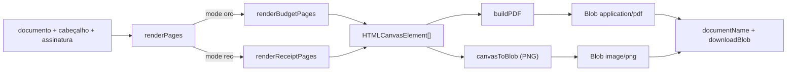

# Motor do documento (A4, fotos, assinatura e exportação)

Todo o desenho do documento vive em `src/lib/document/` e roda **no navegador**,
em `<canvas>`. Não há HTML de impressão nem biblioteca de PDF.

## Sistema de coordenadas

- Medidas em **pontos (pt)**, iguais ao A4 dos PDFs originais.
- `PW = 595.5`, `PH = 842.25` (`constants.ts`).
- `GREY = "#545454"` é a cor padrão de textos e linhas da tabela.
- Fontes: `F_ARIAL` (`Arimo`, fallback Liberation/Arial) para rótulos, e `F_OPEN`
  (`Open Sans`) para o conteúdo da tabela.
- `EXPORT_SCALE = 1654 / PW` ≈ **2.78** (≈200 dpi): o canvas exportado tem
  ~1654 px de largura.
- A prévia usa escala calculada pelo tamanho do container e `devicePixelRatio`,
  com piso de 1.2.

## Arquivos

| Arquivo | Papel |
| --- | --- |
| `constants.ts` | Empresa, tamanho da página, cores, fontes e escala de exportação. |
| `canvas.ts` | `LoadedImage`, carregamento de imagem, fonte, texto espaçado, quebra de linha, linhas, `fitText`, `canvasToBlob`, `createPageCanvas`. |
| `render.ts` | Escolhe orçamento ou recibo e devolve as páginas. |
| `budget.ts` | Layout, densidade e paginação do orçamento. |
| `receipt.ts` | Layout, densidade, paginação, total e assinatura do recibo. |
| `header.ts` | Cabeçalho, rodapé, bloco de cliente e caixa de total. |
| `table.ts` | Cabeçalho da tabela com títulos centralizados e espaçados. |
| `photos.ts` | Cache e recorte das fotos dos produtos. |
| `signature.ts` | Redução, remoção de fundo e recorte da assinatura. |
| `assets.ts` | Carrega `/header.png` uma vez e espera as fontes. |
| `pdf.ts` | Monta o arquivo PDF manualmente (JPEG por página). |
| `download.ts` | Nome do arquivo e download via `<a download>`. |

## Pipeline

Antes de exportar, o `AppShell` executa `ensureFonts()`, garante o cabeçalho
(`ensureHeaderImage`) e espera as fotos (`ensurePhotos`, no máximo 8 s).

## Orçamento (`budget.ts`)

### Colunas

`layoutBudget` monta as posições `xs` conforme as opções:

- Sem foto, sem “UNIT.”: 3 colunas (`[65.7, 359.7, 529.8]`).
- Sem foto, com “UNIT.”: 4 colunas (`[45.7, 330, 430, 549.8]`).
- Com foto: ganha uma coluna estreita à esquerda (FOTO) e desloca as demais.
- Cabeçalhos: `colTitle` (padrão “DESCRIÇÃO”), “QUANTIDADE”, “VALOR UNIT. (R$)"
  quando `unitCol`, e “FOTO” quando há foto.

A coluna de foto só aparece se `doc.photos` estiver ligado **e** existir ao menos
um item com foto válida no cache.

### Densidade

`rowsBudget` calcula altura de cada linha pela quebra de texto e pela foto.
O render tenta, nesta ordem, as densidades:

| Fonte | Entrelinha | Altura mínima |
| --- | --- | --- |
| 12 | 15 | 30 |
| 11.5 | 14 | 26 |
| 11 | 13.5 | 23 |
| 10.5 | 13 | 21 |
| 10 | 12.5 | 19 |

Escolhe a primeira em que tudo cabe em uma página; se nenhuma couber, pagina.

### Paginação

- Limite vertical: `LIMIT = 748`.
- Altura do cabeçalho da tabela: `headH = 35.4`.
- Primeira página: tabela começa em `345` (com CNPJ) ou `325` (sem CNPJ).
- Páginas seguintes: “Continuação — Cliente — data” em `y = 214` e tabela em `225`.
- Rodapé do documento: `tailH` inclui espaço do total e observações.
- Se o rodapé não couber, é criada uma **página só com o rodapé** (`tailOnly`).
- Em mais de uma página, imprime `Página X/Y` em `(550, 834)`.
- Tabela vazia ainda desenha uma linha de espaço.

### Total e observações

- `drawTotalBox` desenha a caixa centralizada com `brl(total)` e devolve o `y` final.
- Observações (“Observação: …”) são quebradas em 360 pt e centralizadas abaixo da
  caixa.
- O bloco de cliente (`drawClient`) é desenhado apenas na primeira página.

## Recibo (`receipt.ts`)

- Colunas fixas: `[58.2, 427.5, 540.8]` (“DESCRIÇÃO” e “VALOR”).
- Primeira linha da tabela começa em `373.2`; continuações em `225`.
- `headH = 50.7`, `LIMIT = 748`.
- Itens totalmente vazios são descartados; se sobrar nenhum, desenha uma linha vazia.
- Caixa de total só aparece quando há **mais de um** item.
- Assinatura:
  - posição padrão da linha: `y = 629.7`, nome em `659.6`;
  - a imagem é desenhada acima da linha, limitada a 200×52 pt;
  - se a tabela for longa, o bloco desce (`top = max(SIG_DEFAULT, bottom + 30)`);
  - sem imagem, a linha e o nome ainda aparecem.
- Paginação e “Página X/Y” seguem a mesma lógica do orçamento.

## Cabeçalho, rodapé e helpers (`header.ts`, `table.ts`, `canvas.ts`)

- `drawHeader` pinta a página de branco e desenha `/header.png` na largura total;
  sem imagem, usa um fallback preto/vermelho. O título (“ORÇAMENTO”/“RECIBO”) é
  branco, 26 pt, com espaçamento de 9.75 pt.
- `drawFooter` imprime contato, telefone, e-mail e CNPJ centralizados a partir de
  `771.2`.
- `drawClient` desenha “Data:”, “Cliente:” e, se ligado, “CNPJ:” com linhas de
  preenchimento. Nome longo é truncado com `fitText`.
- `drawTotalBox` desenha retângulo centralizado de 30.2 pt de altura e largura mínima
  de 123.3 pt.
- `drawTableHead` reduz a fonte do título da coluna (até 7 pt) para caber.
- `wrap` quebra por palavras e, se necessário, quebra palavras longas por caractere.
- `createPageCanvas` cria o canvas no tamanho `PW × scale`/`PH × scale`, aplica
  `ctx.scale(scale, scale)` e `textBaseline = "alphabetic"`.

## Fotos dos produtos (`photos.ts`)

1. `productId(slug)` extrai o número final do slug.
2. A imagem é carregada de **`/foto/<id>`** (mesma origem → o canvas pode exportar).
3. `next.config.ts` repassa `/foto/:id` para a loja e aplica cache de 7 dias.
4. O cache é um `Map` por id, com estado `loading` | `ok` | `err` e uma `Promise`
   `done`.
5. Ao carregar, `trimWhite` recorta a margem branca: varre os pixels (alpha > 20 e
   algum canal < 240), acha a caixa do produto, adiciona 2 px de padding e desenha
   sobre fundo branco.
6. `setPhotoListener` permite que a prévia se redesenhe quando qualquer foto chega.
7. `ensurePhotos` espera todas as fotos do orçamento, com teto de 8 s.
8. `resetPhotos` limpa o cache (usado em teste).

Fotos nunca aparecem no recibo.

## Assinatura (`signature.ts`)

### `shrinkSignature(src, fileSize)`

- Reduz para no máximo 1400 px no maior lado quando a imagem é grande ou o arquivo
  passa de 1.5 MB.
- Converte para PNG (data URL) para caber no `localStorage`.
- Em erro, mantém a imagem original.

### `processSignature(src, clean)`

1. Reduz para no máximo 1400 px.
2. Se `clean`, estima o brilho do papel pela **mediana de luminância** (histograma),
   cria uma rampa alpha entre `hi = max(60, paper - 28)` e `lo = hi - 140`,
   aplica gamma 0.8 e escurece a tinta (0.55/0.55/0.6). Fundo vira transparente.
3. Recorta as bordas sem tinta (com 1% de padding).
4. Exporta PNG e devolve `LoadedImage`.
5. Rejeita quando a imagem não carrega ou fica vazia; o `AppShell` mostra aviso.

## PDF (`pdf.ts`)

- PDF 1.4 escrito à mão, **sem biblioteca**.
- Cada página é uma imagem **JPEG (qualidade 0.92)** em `DCTDecode`.
- `MediaBox` `[0 0 595.28 841.89]` (A4).
- Estrutura: objeto 1 (catálogo), 2 (`Pages`), e 3 objetos por página (page,
  content stream, imagem), seguidos de `xref` e `trailer` com `Producer (J&M System)`.
- O conteúdo da página é `q 595.28 0 0 841.89 0 0 cm /ImN Do Q`.

Consequência: o PDF não tem texto selecionável nem fonte embutida — é imagem. Isso é
intencional e deve ser preservado.

## PNG, cópia e nome do arquivo

- **PNG**: uma imagem por página; downloads com 250 ms de intervalo para o navegador
  não bloquear múltiplos arquivos.
- **Copiar imagem**: usa `ClipboardItem` com a primeira página. Sem suporte ou em
  erro, abre `ImagesDialog` com data URLs para salvar manualmente.
- **Nome** (`documentName`): `"Orçamento|Recibo - Cliente - dd-mm-aaaa (página N).ext"`.
  - Caracteres inválidos do cliente (`\ / : * ? " < > |`) viram espaço.
  - Sem cliente, o nome continua válido.
  - O sufixo de página só aparece quando há mais de uma.

## Como alterar o layout com segurança

1. Mantenha tudo em **pt**; não converta medidas para pixels de tela.
2. Ao mudar colunas, atualize `xs`, `heads` e a largura de descrição juntas.
3. Teste as quatro combinações do orçamento: com/sem foto e com/sem “UNIT.”.
4. Teste 0, 1, muitos itens e um caso que force página só de rodapé.
5. No recibo, teste com/sem assinatura, nome longo e muitos itens.
6. Confirme a prévia e o PDF exportado (a prévia e a exportação usam o mesmo motor,
   só mudam a escala).
7. Atualize este documento se qualquer constante, coluna ou regra mudar.
