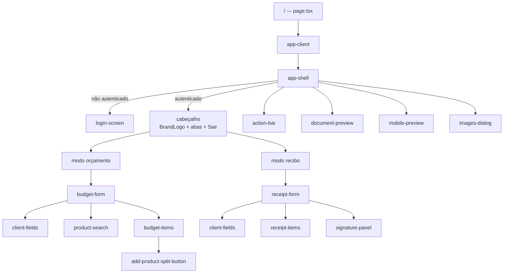

# Páginas e seções da tela

Todas as telas atuais ficam em **uma única rota**: `/`. A página é composta por
seções que moram na própria pasta da rota, em `src/app/(home)/`. A regra de
organização está em [ARCHITECTURE.md](./ARCHITECTURE.md#onde-colocar-código-novo).

## Rotas

| Rota | Arquivo | Observação |
| --- | --- | --- |
| `/` | `src/app/(home)/page.tsx` | Renderiza `AppClient`, que carrega `AppShell` sem SSR. |
| — | `src/app/layout.tsx` | Layout raiz: metadados, `lang="pt-BR"`, fontes e `globals.css`. |

`(home)` é um **route group**: não aparece na URL. Serve para agrupar a rota e
todas as suas seções.

## Mapa da tela

## Seções

| Seção | Arquivo | Responsabilidade | Estado próprio |
| --- | --- | --- | --- |
| `Home` | `page.tsx` | Ponto de entrada da rota. | nenhum |
| `AppClient` | `app-client.tsx` | Carrega o app só no navegador (`ssr: false`). | nenhum |
| `AppShell` | `app-shell.tsx` | Estado central, persistência, catálogo, validação, exportação e layout. | todo o estado do app |
| `LoginScreen` | `login-screen.tsx` | Formulário de entrada. | usuário, senha, “manter conectado”, erro |
| `BudgetForm` | `budget-form.tsx` | Compõe cliente, busca, itens e total do orçamento. | nenhum (ref da busca) |
| `ClientFields` | `client-fields.tsx` | Nome, data e CNPJ do cliente (usado nos dois modos). | nenhum |
| `ProductSearch` | `product-search.tsx` | Busca no catálogo, filtro por categoria e adição rápida. | termo, categoria, item ativo, aberto |
| `BudgetItems` | `budget-items.tsx` | Lista de itens, quantidade, valor, subtotal e configurações. | painel de configurações |
| `AddProductSplitButton` | `add-product-split-button.tsx` | Botão dividido do celular (produto / item personalizado). | menu aberto |
| `ActionBar` | `action-bar.tsx` | Botões de PDF, PNG, copiar, limpar, aviso e versão. | nenhum |
| `DocumentPreview` | `document-preview.tsx` | Desenha os canvases A4 da prévia. | contador de redesenho, rótulo de páginas |
| `MobilePreview` | `mobile-preview.tsx` | Prévia em tela cheia no celular. | nenhum (controlado) |
| `ReceiptForm` | `receipt-form.tsx` | Compõe cliente, itens, assinatura e total do recibo. | nenhum |
| `ReceiptItems` | `receipt-items.tsx` | Lista de descrições e valores do recibo. | nenhum |
| `SignaturePanel` | `signature-panel.tsx` | Envio/arraste da assinatura e ajustes. | arrastando arquivo |
| `ImagesDialog` | `images-dialog.tsx` | Alternativa para salvar a imagem exportada. | nenhum (controlado) |

## `AppShell` em detalhe

É o cérebro da tela. Qualquer nova funcionalidade que envolva estado do documento
passa por aqui.

### Estado

| Estado | Tipo | Persistência | Para que serve |
| --- | --- | --- | --- |
| `authed` | `boolean` | `jm_auth` (via `lib/auth`) | Mostra login ou app. |
| `mode` | `"orc" \| "rec"` | `jm_mode` | Aba ativa. |
| `orc` | `BudgetDoc` | `jm_orc` | Documento de orçamento. |
| `rec` | `ReceiptDoc` | `jm_rec` | Documento de recibo. |
| `priceMemo` | `PriceMemo` | `jm_prices` | Último valor usado por produto (slug). |
| `sigRaw` | `string \| null` | `jm_sig_raw` | Imagem original da assinatura (data URL). |
| `sigClean` | `boolean` | `jm_sig_clean` | Remover fundo do papel. |
| `sigName` | `string` | `jm_sig_name` | Nome impresso sob a linha. |
| `signature` | `LoadedImage \| null` | — | Assinatura processada para o canvas. |
| `header` | `LoadedImage \| null` | — | Cabeçalho do documento carregado. |
| `products` | `CatalogProduct[]` | — | Catálogo em memória. |
| `catalogLoading` / `catalogFailed` | `boolean` | — | Estados da busca. |
| `notice` / `sigNotice` | `Notice` | — | Mensagens de status. |
| `busy` | `boolean` | — | Exportação em andamento. |
| `armed` | `boolean` | — | “Novo documento” pedindo confirmação. |
| `flashId` | `string \| null` | — | Item recém-adicionado (animação). |
| `images` | `HTMLCanvasElement[] \| null` | — | Páginas para o diálogo de imagem. |
| `desktop` | `boolean` | — | Breakpoint de 1024 px. |
| `previewOpen` | `boolean` | — | Prévia em tela cheia no celular. |

### Efeitos

- Carrega o cabeçalho (`ensureHeaderImage`) uma vez.
- Grava cada peça de estado no `localStorage` quando ela muda.
- Busca `/catalog.json` somente depois do login.
- Reprocessa a assinatura quando `sigRaw` ou `sigClean` mudam.
- Observa `matchMedia("(min-width: 1024px)")` para alternar prévia lateral/tela cheia.

### Handlers

| Handler | Efeito |
| --- | --- |
| `patchOrc` / `patchRec` | Mescla campos no documento. |
| `addProduct` | Cria item a partir do catálogo, com último preço (`priceMemo`). |
| `addCustomItem` / `addLaborItem` | Cria item vazio ou “Mão de obra / serviço”. |
| `updateItem` / `moveItem` / `removeItem` | Edita, reordena e remove itens do orçamento; atualiza `priceMemo` ao mudar o valor unitário. |
| `updateReceiptItem` / `removeReceiptItem` / `addReceiptItem` | Equivalentes no recibo. |
| `handleSignatureFile` / `resetSignature` | Valida, reduz e processa (ou remove) a assinatura. |
| `validate` | Exige cliente e ao menos um item (foco no campo `o-cliente` ou `r-cliente`). |
| `renderExportPages` | Prepara fontes/fotos e renderiza as páginas na escala de exportação. |
| `handleDownloadPdf` / `handleDownloadPng` / `handleCopyImage` | Exportações. |
| `handleReset` | Limpeza em dois cliques (`armed` por 4 s). |
| `handleModeChange` / `handleSignOut` | Troca de aba e saída. |

### Layout responsivo

- Desktop (`>= 1024 px`): formulário à esquerda, prévia fixa à direita
  (`DocumentPreview`).
- Celular: prévia em tela cheia aberta por botão flutuante (`MobilePreview`).
- Dentro das listas, `sm:` controla variações de botões e grades.

## `LoginScreen`

- Valida com `checkCredentials` (ver [DATA-MODEL.md](./DATA-MODEL.md)).
- `persistAuth(keep)` grava em `sessionStorage` e, se marcado, em `localStorage`.
- Mostra a versão (`APP_VERSION`).
- Não é segurança real: o login apenas evita acesso casual.

## `BudgetForm`

Compõe, nesta ordem: `ClientFields` (`idPrefix="o"`), `ProductSearch`,
`BudgetItems` e o cartão de total.

Regras do total:

- `totMode = "auto"`: soma `qty × unit` (`budgetTotal`).
- `totMode = "man"`: usa `totManual`; ao trocar para manual com total existente, o
  valor atual é pré-preenchido.
- O botão “Adicionar produto” em `BudgetItems` só leva foco/rolagem até a busca
  (`searchRef`).

## `ClientFields`

- Campos: cliente, data (`type="date"`) e CNPJ opcional (mascarado por `maskCNPJ`).
- IDs prefixados com `o` (orçamento) ou `r` (recibo); a validação usa esses IDs
  para focar o campo com erro.
- Reutilizado pelos dois modos; não adicionar regra específica de um documento aqui
  sem verificar o outro.

## `ProductSearch`

- Fonte: `products` carregado pelo `AppShell`.
- Categoria: `catalogCategories`, com contagem por grupo.
- Busca: `searchProducts(products, query, categoria, 60)`.
- Lista suspensa em portal (`@floating-ui/react`), posicionada abaixo do campo,
  com navegação por `↑`, `↓`, `Enter` e `Escape`.
- Ao escolher, limpa o termo, fecha a lista e chama `onAdd`.
- Mostra “último: R$ …” usando `priceMemo`.
- Link “ver na loja ↗” abre a página do produto na Digital Sat.
- Estado de carregamento/falha altera a mensagem de ajuda.

## `BudgetItems`

- Cabeçalho fixo (`sticky`) com contagem e ações de adicionar.
- Desktop: três botões (`Adicionar produto`, `Item personalizado`,
  `Mão de obra / serviço`). Celular: `AddProductSplitButton` + mão de obra.
- Cada item: número, miniatura (se veio do catálogo), descrição (textarea
  autoajustável), mover para cima/baixo, remover, quantidade, valor unitário
  (`MoneyInput`) e subtotal (`itemSubtotal`).
- Configurações (sanfona):
  - título da coluna de descrição (`colTitle`, máx. 24);
  - mostrar coluna “UNIT.” (`unitCol`);
  - incluir fotos dos produtos (`photos`);
  - observações (`obs`).
- A lista tem altura máxima e rolagem interna.

## `AddProductSplitButton`

- Só aparece no celular (`sm:hidden` no cabeçalho dos itens).
- Parte principal foca a busca; a seta abre o menu “Item personalizado”.
- Usa portal e fecha com clique fora ou `Escape`.

## `ReceiptForm`

Compõe `ClientFields` (`idPrefix="r"`), `ReceiptItems`, `SignaturePanel` e o
cartão “Total recebido” (`receiptTotal`).

## `ReceiptItems`

- Cada linha: descrição (`AutoGrowTextarea`), valor (`MoneyInput`) e remover.
- Dois botões de adicionar: no título e abaixo da lista.
- Recibo novo já nasce com um item vazio (`defaultReceipt`).

## `SignaturePanel`

- Aceita clique ou arraste de imagem (`PNG`/`JPG`).
- Mostra a prévia da imagem original (`sigRaw`).
- Opção “Remover o fundo branco do papel” (`sigClean`).
- Nome de quem assina (`sigName`), máx. 40 caracteres.
- “Remover assinatura” só aparece quando há imagem.
- Mensagens de status vêm de `sigNotice`.

## `ActionBar`

- `Baixar PDF`, `Baixar imagem (PNG)`, `Copiar imagem`, `Novo documento`.
- Todos desabilitados durante `busy`.
- “Novo documento” exige segundo clique (rótulo muda para “Clique de novo para limpar”).
- Área de status (`role="status"`, `aria-live="polite"`) mostra avisos.
- Exibe `v{APP_VERSION}`.

## `DocumentPreview`

- Renderiza os canvases fora do React e os anexa ao container
  (`host.replaceChildren`).
- Escala calculada pelo `clientWidth` (máx. 660 px) e `devicePixelRatio`, com piso
  1.2.
- Redesenha quando documento, cabeçalho, assinatura, nome ou `tick` mudam.
- `setPhotoListener` redesenha quando uma foto termina de carregar.
- `resize` tem debounce de 150 ms.
- Rótulo “A4 · 1 página” ou “N páginas”.

## `MobilePreview`

- Botão flutuante “Ver prévia do PDF”.
- Painel fixo em tela cheia, com `Escape` para fechar.
- Bloqueia o scroll do `body` enquanto aberto.
- Usa `DocumentPreview` com `fill`.

## `ImagesDialog`

- Aberto quando a cópia/baixa automática falha ou não é suportada.
- Converte as páginas em `data:image/png` e orienta a salvar pela imagem.
- `open` é derivado de `pages !== null`.

## Como adicionar uma página nova

1. Criar `src/app/<rota>/page.tsx`.
2. Criar as seções da página **na mesma pasta** e importá-las com caminho relativo.
3. Se a página precisar de estado, criar um shell próprio na pasta e carregá-lo com
   `dynamic(..., { ssr: false })` apenas se depender de APIs do navegador na
   inicialização.
4. Reutilizar `src/components` e `src/lib`; não duplicar formatação, totais ou
   chamadas de canvas.
5. Atualizar este documento e [ARCHITECTURE.md](./ARCHITECTURE.md) se a estrutura
   mudar.
