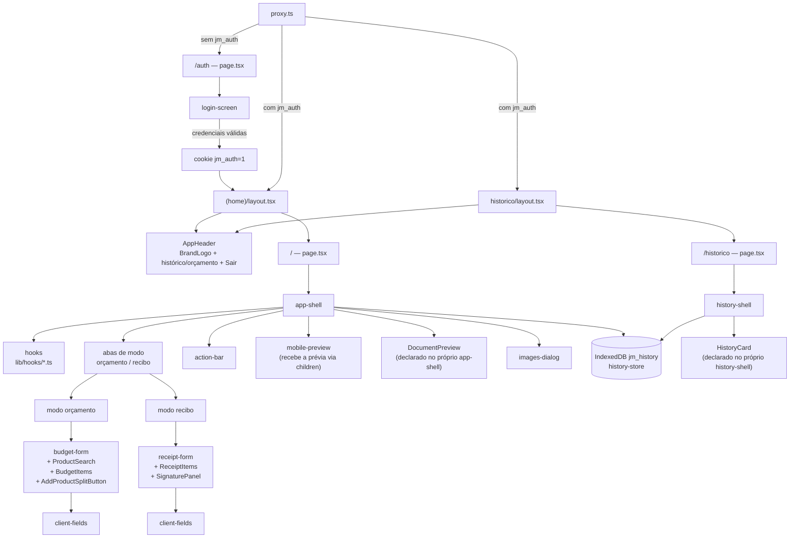

# Páginas e seções da tela

As telas ficam em **duas rotas protegidas**: `/` (orçamento e recibo) e
`/historico` (documentos salvos). Cada rota é composta por seções que moram na
própria pasta da rota, em `src/app/(home)/` e `src/app/historico/`. O cabeçalho
(marca, atalho entre as duas telas e sair) é compartilhado e vive em
`src/components/app-header.tsx`, porque não depende do documento aberto nem da
rota; as abas de modo são uma seção da página inicial. A regra de organização
está em [ARCHITECTURE.md](./ARCHITECTURE.md#onde-colocar-código-novo).

## Rotas

| Rota | Arquivo | Observação |
| --- | --- | --- |
| `/` | `src/app/(home)/page.tsx` | Carrega `AppShell` com `ssr: false` (é client component). Protegida pelo proxy. |
| — | `src/app/(home)/layout.tsx` | Layout da rota protegida: fundo da página e cabeçalho (`AppHeader`). |
| `/historico` | `src/app/historico/page.tsx` | Carrega `HistoryShell` com `ssr: false` (IndexedDB e `localStorage`). Protegida pelo proxy. |
| — | `src/app/historico/layout.tsx` | Layout da rota do histórico: o mesmo fundo e o mesmo `AppHeader`. |
| `/auth` | `src/app/auth/page.tsx` | Renderiza `LoginScreen`; grava o cookie `jm_auth` e volta para `/`. |
| — | `src/app/layout.tsx` | Layout raiz: metadados, `lang="pt-BR"`, fontes e `globals.css`. |
| — | `src/proxy.ts` | Sem o cookie `jm_auth`, redireciona para `/auth`. |

`(home)` é um **route group**: não aparece na URL. Serve para agrupar a rota e
todas as suas seções. `historico` é uma pasta normal: entra na URL como
`/historico`.

## Mapa da tela

## Seções

A pasta de cada rota tem poucos arquivos de propósito: cada componente auxiliar é
declarado **no topo do arquivo que o usa**, fora da função do componente
chamador, e não vira arquivo próprio. O que sobra são as seções da página, as
rotas (`page.tsx` / `layout.tsx`) e os componentes reaproveitados pelas duas telas
e pelos dois modos.

| Seção | Arquivo | Responsabilidade | Estado próprio |
| --- | --- | --- | --- |
| `Home` | `(home)/page.tsx` | Ponto de entrada da rota protegida; carrega `AppShell` no navegador (`ssr: false`). | nenhum |
| `AuthPage` | `auth/page.tsx` | Ponto de entrada da rota `/auth`. | nenhum |
| `HomeLayout` | `(home)/layout.tsx` | Fundo da página e cabeçalho da rota protegida; contém `AppHeader`. | nenhum |
| `AppShell` | `app-shell.tsx` | Abas de modo, validação, exportação, composição dos hooks; contém `DocumentPreview`. | aviso, ocupado, limpeza armada, imagens |
| `AppHeader` | `components/app-header.tsx` | Marca, atalho entre `/` e `/historico` (ícone muda com a rota) e sair; usado pelos dois layouts. | nenhum (lê `usePathname`) |
| `HistoryPage` | `historico/page.tsx` | Ponto de entrada de `/historico`; carrega `HistoryShell` (`ssr: false`). | nenhum |
| `HistoryLayout` | `historico/layout.tsx` | Fundo e cabeçalho da rota do histórico; contém `AppHeader`. | nenhum |
| `HistoryShell` | `historico/history-shell.tsx` | Filtro orçamento/recibo, lista de cards e ações (abrir, baixar, pedir orçamento). Contém `HistoryCard` e `HistoryList` (grade virtualizada). | filtro, aviso, card ocupado |
| `LoginScreen` | `auth/login-screen.tsx` | Formulário de entrada; grava o cookie e navega para `/`. | usuário, senha, “manter conectado”, erro |
| `BudgetForm` | `budget-form.tsx` | Compõe cliente, busca, itens e total do orçamento; edita os itens. Contém `ProductSearch`, `BudgetItems` e `AddProductSplitButton`. | nenhum (ref da busca) |
| `ClientFields` | `client-fields.tsx` | Nome, data e CNPJ do cliente (usado nos dois modos). | nenhum |
| `ReceiptForm` | `receipt-form.tsx` | Compõe cliente, itens, assinatura e total do recibo; edita itens e assinatura. Contém `ReceiptItems` e `SignaturePanel`. | nenhum |
| `ActionBar` | `action-bar.tsx` | Botões de PDF, PNG, copiar, limpar, aviso e versão. | nenhum |
| `MobilePreview` | `mobile-preview.tsx` | Prévia em tela cheia no celular; recebe a prévia por `children`. | nenhum (controlado) |
| `ImagesDialog` | `images-dialog.tsx` | Alternativa para salvar a imagem exportada. | nenhum (controlado) |

## Abas de modo

- São uma **seção da página**, dentro de `<main>` e acima da grade; não ficam mais
  no `<header>`.
- Controladas por `mode` (`jm_mode`) e `handleModeChange`, ambos no `AppShell`.
- “Fazer orçamento” renderiza `BudgetForm`; “Fazer recibo”, `ReceiptForm`.
- No celular ocupam a largura toda; a partir de `sm` ficam no tamanho do conteúdo.

## `AppShell` em detalhe

`AppShell` guarda o estado que precisa cruzar modos (documentos, preferências,
aviso, exportação, limpeza e diálogo de imagens) e desenha as abas de modo, mas
**não** desenha o cabeçalho: ele vem do layout da rota. O resto vem de hooks e as
mutações de cada documento ficam no próprio formulário.

### Estado

| Estado | Origem | Persistência | Para que serve |
| --- | --- | --- | --- |
| `mode` | `usePersistedState` | `jm_mode` | Aba ativa. |
| `orc` | `usePersistedState` | `jm_orc` | Documento de orçamento. |
| `rec` | `usePersistedState` | `jm_rec` | Documento de recibo. |
| `priceMemo` | `usePersistedState` | `jm_prices` | Último valor usado por produto (slug). |
| `company` | prop (vinda de `page.tsx`, que usa `useCompany`) | `jm_company` | Empresa que emite o documento. Trocar remonta o `AppShell` (`key={company}`). |
| `sigRaw` | `usePersistedState` | `jm_sig_raw` (+ sufixo da empresa) | Imagem original da assinatura (data URL). |
| `sigClean` | `usePersistedState` | `jm_sig_clean` (+ sufixo) | Remover fundo do papel. |
| `sigName` | `usePersistedState` | `jm_sig_name` (+ sufixo) | Nome impresso sob a linha; padrão é o `signer` da empresa. |
| `pendingShare` | `useState` | — | Arquivos esperando um toque para abrir o compartilhamento do celular (`ShareFilesDialog`). |
| `notice` | `useState` | — | Aviso da barra de ações. |
| `busy` | `useState` | — | Exportação em andamento. |
| `armed` | `useState` | — | “Novo documento” pedindo confirmação. |
| `images` | `useState` | — | Páginas para o diálogo de imagem. |
| `documentId` | `useDocumentId` | `jm_doc_id` | Id do documento em edição; chave da entrada no histórico. |

Os documentos e as preferências são compartilhados entre modos, então continuam
no `AppShell`; as mutações, porém, moram em quem as dispara (ver handlers).

### Hooks

Cada hook é dono de uma tarefa única e vive em `src/lib/hooks/`.

`AppShell` não declara nenhum `useEffect`; todo efeito vive no hook
correspondente.

| Hook | Arquivo | Retorno |
| --- | --- | --- |
| `usePersistedState` | `lib/hooks/persisted-state.ts` | `[valor, setValor]` espelhado no `localStorage`; `restore` define o padrão. |
| `useCatalog` | `lib/hooks/catalog.ts` | `{ products, loading, failed }` a partir de `/catalog.json`. |
| `useHeaderImage` | `lib/hooks/header-image.ts` | `LoadedImage \| null` do cabeçalho da empresa (recebe `company`). |
| `useCompany` | `lib/hooks/company.ts` | `[company, setCompany]`: empresa escolhida, compartilhada entre cabeçalho, login e tela (e entre abas) via `useSyncExternalStore`. |
| `useSignatureImage` | `lib/hooks/signature-image.ts` | `{ image, notice, setNotice }` da assinatura processada. |
| `useDesktopPreview` | `lib/hooks/desktop-preview.ts` | `{ desktop, previewOpen, setPreviewOpen }` conforme `matchMedia`. |
| `useFlash` | `lib/hooks/flash.ts` | `{ flashId, flash }` para destacar item novo por 1,5 s. |
| `useDocumentId` | `lib/hooks/document-id.ts` | `{ id, renew }` do documento em edição (cria na primeira visita, renova em “Novo documento”). |
| `useHistoryEntries` | `lib/hooks/history.ts` | `{ entries, loading, failed }` do IndexedDB, sem os expirados. |

### Handlers

| Handler | Arquivo | Efeito |
| --- | --- | --- |
| `patch` | `budget-form.tsx` / `receipt-form.tsx` | Mescla campos no documento. |
| `addProduct` | `budget-form.tsx` | Cria item a partir do catálogo, com último preço (`priceMemo`). |
| `addCustomItem` / `addLaborItem` | `budget-form.tsx` | Cria item vazio ou “Mão de obra / serviço”. |
| `updateItem` / `moveItem` / `removeItem` | `budget-form.tsx` | Edita, reordena e remove itens do orçamento; atualiza `priceMemo` ao mudar o valor unitário. |
| `updateItem` / `removeItem` / `addItem` | `receipt-form.tsx` | Equivalentes no recibo. |
| `handleSignatureFile` / `resetSignature` | `receipt-form.tsx` | Valida, reduz e processa (ou remove) a assinatura. |
| `validate` | `app-shell.tsx` | Exige cliente e valida os itens do orçamento com zod (ao menos um item, quantidade e valor unitário maiores que zero; foco no campo inválido). |
| `formValid` (derivado) | `app-shell.tsx` | `formErrors` + `formIsValid` sobre `budgetFormSchema`/`receiptFormSchema`; alimenta o `isValid` do `ActionBar`. |
| `renderExportPages` | `app-shell.tsx` → `lib/document/export.ts` | Prepara fontes/fotos e renderiza as páginas na escala de exportação (a implementação é compartilhada com o histórico). |
| `handleDownloadPdf` / `handleDownloadPng` / `handleCopyImage` | `app-shell.tsx` | Exportações (dependem do modo e do documento validado) e gravação no histórico (`saveToHistory`). |
| `saveToHistory` | `app-shell.tsx` | Grava o documento no IndexedDB com o `documentId` atual; falha em silêncio para não quebrar a exportação. |
| `handleReset` | `app-shell.tsx` | Limpeza em dois cliques (`armed` por 4 s) e renovação do `documentId` (`renew`). |
| `handleModeChange` | `app-shell.tsx` | Troca a aba ativa e limpa aviso e limpeza armada. |
| `handleSignOut` | `components/app-header.tsx` | Limpa o cookie (`clearAuth`) e navega para `/auth`. |

### Layout responsivo

- Desktop (`>= 1024 px`): formulário à esquerda, prévia fixa à direita
  (`DocumentPreview`).
- Celular: prévia em tela cheia aberta por botão flutuante (`MobilePreview`).
- Dentro das listas, `sm:` controla variações de botões e grades.

## `AppHeader` (cabeçalho compartilhado)

- Fica em `src/components` porque os dois layouts (`(home)` e `historico`) o
  usam; não depende do documento aberto, só da rota (`usePathname`).
- À esquerda, o seletor de empresa: a marca da empresa escolhida abre um menu com
  “J&M System” e “Vision Tech”. A troca vale na hora para a prévia e para os
  próximos PDFs; o documento em edição não muda.
- À direita, o atalho entre as telas e “Sair”.
- O atalho é um `Link` com ícone `History` em `/` e ícone `FileText` em
  `/historico` (o `aria-label` acompanha: “Histórico” / “Voltar para o orçamento”).

## `HistoryShell` (`/historico`)

- Lista o que está no IndexedDB (`useHistoryEntries` já descarta o que passou dos
  30 dias) e filtra por modo com as mesmas `Tabs` da tela inicial; o padrão é
  **orçamentos**.
- Cada card (`HistoryCard`, declarado no topo de `history-shell.tsx`) mostra nome
  do cliente, data, tipo, empresa e valor, e traz no extremo direito o menu de três
  pontinhos (`DropdownMenu` de `src/components/ui`).
- A lista é **virtualizada** (`HistoryList`, também no topo do arquivo) com
  `useVirtualizer` do `@tanstack/react-virtual`: só os cards visíveis, mais a
  folga de 3, são montados. A grade usa `lanes` — 1, 2 ou 3 colunas conforme a
  largura da própria lista (cortes de 600 px e 1200 px), com `gap` de 12 px — e
  a altura do card é medida (`measureElement`), partindo de 92 px.
- Por causa da virtualização, a rolagem acontece **dentro da lista**
  (`max-h-[calc(100dvh-12rem)]`), e não na página. Trocar de aba volta ao topo.
- Ações do menu:
  - **Abrir**: `restoreHistoryEntry` devolve documento, modo, assinatura, id e
    **empresa** ao `localStorage` e navega para `/`.
  - **Baixar**: redesenha as páginas com `renderExportPages` a partir de
    `entry.doc` + `entry.signature` + `entry.company` e entrega o PDF
    (`deliverFiles`: baixa no computador, compartilha no celular).
  - **Pedir orçamento** (só em orçamento): `quoteText` monta a lista
    `produto  quantidadeX` e copia para a área de transferência.
- O arquivo exportado nunca é guardado: o card redesenha o PDF quando pedido.

## `LoginScreen`

- Fica em `src/app/auth`, fora do route group `(home)`.
- Valida com `checkCredentials` (ver [DATA-MODEL.md](./DATA-MODEL.md)).
- `persistAuth(keep)` grava o cookie `jm_auth=1`: cookie de sessão por padrão e,
  com “manter conectado”, com validade de 30 dias.
- Ao entrar, faz navegação completa para `/`; o proxy já vê o cookie recém-gravado
  e libera a rota.
- Tem a escolha da **empresa** (`CompanyPicker`, no topo do arquivo): dois botões
  com as marcas, `role="radio"`. A escolha é gravada na hora com `useCompany` e a
  marca no topo do cartão acompanha.
- Mostra a versão (`APP_VERSION`).
- Não é segurança real: o login apenas evita acesso casual.

## `proxy.ts`

- Roda antes das rotas que não são `/auth` nem arquivos estáticos.
- Sem `jm_auth=1`, redireciona para `/auth`.
- É uma checagem otimista de navegação, não uma sessão de servidor: credenciais,
  dados e documentos continuam no navegador.

## `BudgetForm`

Compõe, nesta ordem: `ClientFields` (`idPrefix="o"`), `ProductSearch`,
`BudgetItems` e o cartão de total.

Regras do total:

- `totMode = "auto"`: soma `qty × unit` (`budgetTotal`).
- `totMode = "man"`: usa `totManual`; ao trocar para manual com total existente, o
  valor atual é pré-preenchido.
- O botão “Adicionar produto” em `BudgetItems` só leva foco/rolagem até a busca
  (`searchRef`).
- `addProduct` impede duplicidade: se o `slug` já está em `doc.items`, mostra
  “Este produto já está adicionado ao orçamento.” e não cria outro item.
- `addedSlugs` (derivado de `doc.items`) é repassado a `ProductSearch` para marcar
  os produtos que já estão na lista.
- A exportação exige cliente, ao menos um item e, para cada item, quantidade e
  valor unitário maiores que zero (`validateBudgetItems`). Enquanto o documento
  atual tiver erro no schema, os botões de exportação do `ActionBar` ficam
  desabilitados.

## `ClientFields`

- Campos: cliente, data (`type="date"`) e CNPJ opcional (mascarado por `maskCNPJ`).
- IDs prefixados com `o` (orçamento) ou `r` (recibo); a validação do `AppShell` usa
  esses IDs para focar o campo com erro (`o-cliente`/`r-cliente`).
- Usa o contexto de formulário: `<Form schema={clientFieldsSchema}>` +
  `InputLayout`. Os campos continuam vindo das props e cada edição sobe por
  `onChange({ campo: valor })` — o `AppShell` segue dono do documento.
- Erro por campo vem de `src/lib/schemas/client.ts`; o campo só aparece inválido
  depois de editado (`dirty`).
- Reutilizado pelos dois modos; não adicionar regra específica de um documento aqui
  sem verificar o outro.

## `ProductSearch` (dentro de `budget-form.tsx`)

- Fonte: `products` carregado pelo `AppShell`.
- Categoria: `catalogCategories`, com contagem por grupo.
- Busca: `searchProducts(products, query, categoria, 60)`.
- Lista suspensa em portal (`@floating-ui/react`), posicionada abaixo do campo,
  com navegação por `↑`, `↓`, `Enter` e `Escape`.
- Ao escolher, limpa o termo, fecha a lista e chama `onAdd`.
- Produtos que já estão em `doc.items` aparecem riscados, com opacidade reduzida
  e o selo “Já adicionado” (o item continua visível, mas não é adicionado de novo;
  clicar mostra o aviso de duplicidade).
- Mostra “último: R$ …” usando `priceMemo`.
- Link “ver na loja ↗” abre a página do produto na Digital Sat.
- Estado de carregamento/falha altera a mensagem de ajuda.

## `BudgetItems` (dentro de `budget-form.tsx`)

- Cabeçalho fixo (`sticky`) com contagem e ações de adicionar.
- Desktop: três botões (`Adicionar produto`, `Item personalizado`,
  `Mão de obra / serviço`). Celular: `AddProductSplitButton` + mão de obra.
- Cada item: número, miniatura (se veio do catálogo), descrição (textarea
  autoajustável), mover para cima/baixo, remover, quantidade, valor unitário
  (`MoneyInputLayout`) e subtotal (`itemSubtotal`).
- Cada linha é um `<Form schema={budgetItemSchema}>` próprio: quantidade e valor
  unitário usam `InputLayout`/`MoneyInputLayout` com `size="sm"` e ids
  `qty-<id>`/`unit-<id>` (os mesmos que o `AppShell.validate()` foca). Zerar ou
  deixar vazio marca a borda de erro (`aria-invalid`) e mostra a mensagem do
  schema embaixo do input — só depois que o campo foi editado.
- Configurações (sanfona):
  - título da coluna de descrição (`colTitle`, máx. 24);
  - mostrar coluna “UNIT.” (`unitCol`);
  - incluir fotos dos produtos (`photos`);
  - observações (`obs`).
- A lista tem altura máxima e rolagem interna.

## `AddProductSplitButton` (dentro de `budget-form.tsx`)

- Só aparece no celular (`sm:hidden` no cabeçalho dos itens).
- Parte principal foca a busca; a seta abre o menu “Item personalizado”.
- Usa portal e fecha com clique fora ou `Escape`.

## `ReceiptForm`

Compõe `ClientFields` (`idPrefix="r"`), `ReceiptItems`, `SignaturePanel` e o
cartão “Total recebido” (`receiptTotal`).

## `ReceiptItems` (dentro de `receipt-form.tsx`)

- Cada linha: descrição (`AutoGrowTextarea`), valor (`MoneyInput`) e remover.
- Dois botões de adicionar: no título e abaixo da lista.
- Recibo novo já nasce com um item vazio (`defaultReceipt`).

## `SignaturePanel` (dentro de `receipt-form.tsx`)

- Aceita clique ou arraste de imagem (`PNG`/`JPG`).
- Mostra a prévia da imagem original (`sigRaw`).
- Opção “Remover o fundo branco do papel” (`sigClean`).
- Nome de quem assina (`sigName`), máx. 40 caracteres.
- “Remover assinatura” só aparece quando há imagem.
- Mensagens de status vêm de `sigNotice`.

## `ActionBar`

- `Baixar PDF`, `Baixar imagem (PNG)`, `Copiar imagem`, `Novo documento`.
- PDF/PNG/copiar ficam desabilitados durante `busy` **e** quando o formulário do
  modo atual tem erro (`isValid` vindo do `AppShell`); nesse caso a área de status
  mostra “Complete os dados do documento para exportar.”.
- “Novo documento” continua habilitado (só depende de `busy`).
- “Novo documento” exige segundo clique (rótulo muda para “Clique de novo para limpar”).
- Área de status (`role="status"`, `aria-live="polite"`) mostra avisos.
- Exibe `v{APP_VERSION}`.

## `DocumentPreview` (dentro de `app-shell.tsx`)

- Renderiza os canvases fora do React e os anexa ao container
  (`host.replaceChildren`).
- Escala calculada pelo `clientWidth` (máx. 660 px) e `devicePixelRatio`, com piso
  1.2.
- Redesenha quando documento, cabeçalho, assinatura, nome ou `tick` mudam.
- `setPhotoListener` redesenha quando uma foto termina de carregar.
- `resize` tem debounce de 150 ms.
- Rótulo “A4 · 1 página” ou “N páginas”.

## `MobilePreview`

- Botão flutuante “Ver prévia do PDF”.
- Painel fixo em tela cheia, com `Escape` para fechar.
- Bloqueia o scroll do `body` enquanto aberto.
- Não conhece o documento: recebe a prévia pronta por `children` (o `AppShell`
  passa `<DocumentPreview fill />`).

## `ImagesDialog`

- Aberto quando a cópia/baixa automática falha ou não é suportada.
- Converte as páginas em `data:image/png` e orienta a salvar pela imagem.
- `open` é derivado de `pages !== null`.

## Como adicionar uma página nova

1. Criar `src/app/<rota>/page.tsx`.
2. Se a página tiver cabeçalho próprio, criar `src/app/<rota>/layout.tsx` com ele:
   o cabeçalho não pertence ao shell cliente.
3. Criar as seções da página **na mesma pasta** e importá-las com caminho relativo.
4. Se a página precisar de estado, criar um shell próprio na pasta e carregá-lo com
   `dynamic(..., { ssr: false })` **a partir de um client component** (o próprio
   `page.tsx` com `"use client"`), nunca de um server component.
5. Antes de criar um arquivo novo, verifique se o componente é usado por um único
   chamador: nesse caso ele deve ser declarado no topo desse arquivo.
6. Reutilizar `src/components` e `src/lib`; não duplicar formatação, totais ou
   chamadas de canvas.
7. Atualizar este documento e [ARCHITECTURE.md](./ARCHITECTURE.md) se a estrutura
   mudar.
